# The feature-ablation pilot v2, explained

This document explains, in plain language, what the second pilot run (v2) was for, how it differs
from the first (v1), how it was designed, and what it found. It assumes you know the v1 pilot
(`pilot-results-explained.md`) but nothing about v2. The technical specification is
`pilot-v2-amendment.md`. The machine-generated report, with every number, is
`runs/feature-ablation-v2-runs_20-11-2026/confirm/20261119-061824-confirm/report_v2.md`.

## The short version

- **The question is the same as in v1.** When researchers look for the parts of a language model
  that cause a behaviour, which matters more: *what kind of parts* they use (the **basis**), or
  *how they pick* them (the **selection rule**)? v2 turns two of v1's unofficial hints into claims
  that were written down and frozen before the main run:
  - **C1:** picking parts by their predicted effect on the behaviour (*causal* picking) beats picking
    them by how much they differ between groups (*readout* picking).
  - **C2:** which kind of part looks best depends on the picking rule.
- **What changed from v1.**
  - v1 failed its own sanity checks, mostly because we edited only 9 formatting tokens. v2 edits
    every token of the prompt, and for refusal also every token the model writes.
  - It looks at 3–5 depths in the model instead of one layer.
  - It adds two fresh tasks (sentiment, answerability) and a second, larger model (Qwen3.5-4B).
  - It compares methods at one fixed level of collateral damage.
- **The verdict is NOT SUPPORTED.** Neither main claim passed its pre-set bar.
  - C1 held in 0 of 6 test pairs (it needed 5).
  - C2 held in 2 of 6 (it needed 3).
  - A secondary claim, C3 ("how clearly a unit carries information barely predicts its effect"),
    passed, but mostly because the small groups of units it tests did almost nothing.
- **The main pattern: causal picking helps in only one basis.**
  - Using the model's raw numbers (`dims`), causal picking beat readout picking in 4 of 6 pairs.
  - Using PCA axes, it never did. Using SAE features (smaller model only), readout picking was better.
  - C1 averages over the bases, and these opposite effects cancel out, so no pair passed.
- **The middle layer was the quiet one.**
  - At the main depth (50%), most methods barely dented the behaviours at the comparison cost.
  - Deeper in the model (75% on Qwen3-1.7B, 60% on Qwen3.5-4B), causal picking beat readout picking
    by large margins in several tasks. For example, it cut sentiment AUROC by about 0.6 where readout
    picking did nothing.
  - These depth results are descriptive, not pre-registered tests.
- **The SAE for Qwen3.5-4B was given inputs at the wrong scale.**
  - It failed the quality check at every depth, so that model was tested with PCA axes and raw numbers
    only.
  - A check after the run found the cause: the harness gave it activations about 5 times smaller
    than it was built for (Section 4.8).
- **A missing control was recovered after the run.**
  - The cross-task control asks whether units picked for one task also hurt another task. The
    frozen analysis left it empty because of a one-word bug.
  - Computed afterwards from the saved data, it mostly finds the picks task-specific, where it can be
    tested at all (Section 4.7). This is a post-freeze result.
- **The verdict depends on the comparison cost (post-freeze, exploratory).**
  - Rerunning the frozen tests at the secondary costs gives NOT SUPPORTED at 0.02 and PARTIALLY
    SUPPORTED at 0.5. At 0.5, C2 reaches its bar but C1 holds in only 1 of 6 pairs.
  - Even at 0.5, one basis usually goes against causal picking.
  - On Qwen3-1.7B, scrambled-label attribution does about as much damage as the real thing at that
    cost, so those large wins are not clearly tied to the task (Section 4.11).
- **The run worked, but took longer than planned.**
  - All machinery checks passed, after one was made tolerant of rounding noise.
  - The main run used about 14.4 GPU hours instead of the planned ~9.
  - The operator raised the time limit partway through, so all five planned blocks of work finished.
    Two of them would otherwise have been skipped. The report does not list this as a deviation
    (Section 6).

---

## 1. Why v2 exists

v1 ended with the verdict **INVALID HARNESS**: two of its own sanity checks failed, so its main
results could not be interpreted. Its unofficial patterns were nonetheless interesting. Causal
picking roughly doubled the damage to refusal, and which basis looked best flipped with the picking
rule. v2 fixes what made v1 fail and then tests those patterns properly.

| What went wrong or was missing in v1 | What v2 does instead |
|---|---|
| Truth could not be broken. We edited only the 9 formatting tokens after the user's message, while the facts ("Lodz", "Poland") sit on the user's own words. | Edit **every prompt token**. For refusal, also edit **every token the model generates**. |
| The refusal reference fell just short of its 0.5 bar, random picks did too much, and that one check (H0) decided the whole verdict. | Judge every method by its damage **beyond random** at a **fixed cost**. H0 is still reported, but only as a caveat. |
| Random curves stopped at 500 units, before reaching the cost they were compared at. | Every curve keeps doubling the number of units (1,000, 2,000, …) until it reaches its comparison cost. |
| One layer (14 of 28). | Three depths on Qwen3-1.7B, five on Qwen3.5-4B. |
| Two tasks, both already studied, on one model. | Two new tasks and a second, larger model, so the claims are tested on data that did not shape them. |
| One run. | Smoke test → development run → **freeze** the plan → confirmatory run (Section 2.9). |
| One typical value per fixed position (the 9 tokens are the same in every prompt). | One typical value per unit for prompt tokens and one for generated tokens, since prompts now differ in length. |

---

## 2. How the experiment is built

### 2.1 The models and depths

| | Qwen3-1.7B | Qwen3.5-4B |
|---|---|---|
| Role | The v1 model | New: a larger model with a different internal design. Most of its layers use a newer, recurrent kind of attention ("Gated DeltaNet"). |
| Size | 28 layers, 2,048 numbers per token | 32 layers, 2,560 numbers per token |
| Depths run | 25%, 50%, 75% (layers 7, 14, 21) | 25%, 40%, 50%, 60%, 75% (layers 8, 13, 16, 19, 24) |
| SAE | The same public SAE as v1, now at all three layers | A public SAE from the REINS paper, one per layer. It was trained on the *base* version of the model, not the chat version we use. |

"Depth" means how far through the model: 50% is the middle layer. **50% is the primary depth**; the
main claims are tested there. The other depths are secondary. Qwen3-1.7B runs only three depths
because its SAE exists only at those three.

### 2.2 Where we intervene

Every token now has one of three roles:

- **Prompt tokens:** everything the model reads. That includes the user's own words, the chat-format
  tokens and the empty "thinking" block.
- **Generated tokens:** everything the model writes in its reply.
- **Never touched:**
  - The very first token.
  - Padding.
  - "Attention sinks": tokens whose internal values are more than 10 times the typical size. The
    model uses these as a resting place for attention, and editing them wrecks it.

Using the v1 truth prompt as an example: v1 edited only the 9 formatting tokens after "Poland.". v2
also edits "Statement: The city of Lodz is in Poland." and the instruction before it.

There are two **sites**, i.e. sets of tokens we edit:

| Site | Tokens edited | Used for |
|---|---|---|
| S1 | All prompt tokens | All tasks (the main site) |
| S2 | All prompt tokens, plus each new token as the model generates it | Refusal only |

For the single-answer tasks (truth, sentiment, answerability), the answer is read at the first reply
position, which the model computes from the prompt alone. S2 would be identical to S1 there, so it
is not run.

### 2.3 The tasks

| Task | What the model sees | Score |
|---|---|---|
| **Truth** | "Answer with True or False only. Statement: The city of X is in Y." (as in v1) | AUROC of its preference for True over False |
| **Refusal** | Harmful and harmless requests (as in v1) | Refusal rate, judged from 32 generated words |
| **Sentiment** (new) | "Is the sentiment of this review positive or negative? Answer with Positive or Negative only. Review: …" (movie reviews, SST-2) | AUROC |
| **Answerability** (new) | "Read the passage and decide whether the question can be answered from it. Answer with Yes or No only. Passage: … Question: …" (SQuAD 2.0, passages of at most 150 tokens) | AUROC |
| **Toxicity** (backup) | "Is the following comment toxic? …" | Used only if a new task failed its entry check. It was not needed. |

**Development vs. confirmatory pairs.** A "pair" is one model on one task.

- **Development pairs:** truth and refusal on Qwen3-1.7B. We already studied these in v1 and in the
  development run, so they could have shaped our expectations. They are reported but never counted
  toward C1–C3.
- **Confirmatory pairs:** the other six. These are sentiment and answerability on Qwen3-1.7B, plus all
  four tasks on Qwen3.5-4B.

**Data sizes.**

- Units are chosen on 1,000 "discovery" examples per new task, and tested on separate "eval" examples:
  - sentiment: 500
  - answerability: 400
  - truth: 500
  - refusal: 200 harmful and 100 harmless prompts
- Collateral damage is measured on 100 ordinary prompts.

**Entry check.** A pair enters the analysis only if the untouched model handles the task well: AUROC
at least 0.85 for single-answer tasks; for refusal, at least 150 harmful prompts refused and at most
10% of harmless ones. All eight pairs passed:

| Task | Qwen3-1.7B | Qwen3.5-4B |
|---|---|---|
| Truth (AUROC) | 0.91 | 1.00 |
| Sentiment (AUROC) | 0.97 | 0.98 |
| Answerability (AUROC) | 0.88 | 0.96 |
| Refusal: harmful prompts refused | 247 of 562 (44%) | 544 of 562 (97%) |
| Refusal: harmless prompts refused | 0% | 1% |
| Toxicity (backup, AUROC) | 0.75 (would have failed) | 0.86 |

The larger model refuses harmful requests far more consistently, and that matters later: its refusal
is much harder to break.

### 2.4 What we vary

This is the same as in v1 (see `pilot-results-explained.md`, Section 2), with a few changes:

- **Bases:** `dims` (raw numbers), `pca` (re-expressed along axes of variation) and `sae` (learned
  dictionary of features). The SAE was dropped wherever it failed its quality check, which happened
  at every depth of Qwen3.5-4B (Section 4.8).
- **Selection rules:**
  - `meandiff` and `l1probe`: readout picking.
  - `attrib`: causal picking (how it scores units is explained in Section 2.5).
  - `random`: the floor.

  Each unit's value for an example is now its average over that example's prompt tokens.
- **A new control, `attrib_shuffled`:** causal picking computed with the group labels scrambled.
  If causal picking really finds units that matter *for this task*, the scrambled version should do
  no better than random.
- **Strategy:** mean ablation everywhere; resample ablation for refusal only, as a secondary check.
- **Budgets:** 1, 5, 20, 50, 100, 200 and 500 units. If a curve's collateral damage is still below its
  target, it continues with 1,000, 2,000, … units.
  - Only 2 curves ran out of units before reaching their target. Both were SAE features picked by
    `l1probe` on Qwen3-1.7B answerability, which can use at most 8,192 features.
  - Both still passed the comparison cost of 0.1, so no result is affected.

### 2.5 How causal picking scores a unit

Causal picking (`attrib`) gives every unit a score, its **attribution**. The score predicts how much
switching that unit off would hurt the behaviour. Units are then switched off in order, the most
damaging first. The recipe is the same in every basis. Only two ingredients change between bases:
how a unit's value is read, and which direction the unit points in.

**Where it happens: the residual stream.** As in v1, the model keeps a list of numbers for every
token at every layer: 2,048 on Qwen3-1.7B, 2,560 on Qwen3.5-4B. Each layer reads this list, computes
something, and *adds* its result back. The list is a running total that every layer writes into,
and it is called the **residual stream**. All edits happen in the residual stream right after the
chosen layer. Both SAEs were also trained at that point.

**Each unit is a direction.** A basis describes the residual stream as a sum of pieces:

> residual stream ≈ starting point + (value of unit 1 × direction of unit 1) + (value of unit 2 ×
> direction of unit 2) + …

- A unit's **value** says how much of it is present at a token.
- Its **direction** is a list of numbers the same length as the residual stream. It says how the
  residual stream moves when the unit's value goes up by 1.
- Switching a unit off (mean ablation) replaces its value with its typical value. That moves the
  residual stream along the unit's direction, and nowhere else.

| Basis | A unit's value at a token | A unit's direction | Where the direction comes from |
|---|---|---|---|
| `dims` | Number i of the residual stream | 1 at position i, 0 everywhere else | Nothing to compute |
| `pca` | How far the token sits along axis i, measured from the average token | Axis i | Fitted once per model and depth. About 20,000 token states at that layer (from ordinary prompts and every task's discovery prompts) are collected, and the axes along which they vary most are found. The axes are at right angles to one another. |
| `sae` | The feature's activation, from the SAE's encoder | Row i of the SAE's decoder, scaled back to the model's real size | Comes with the downloaded SAE. The Qwen3-1.7B SAE takes raw inputs, so no scaling is needed. |

SAE features differ from PCA axes in three ways:

- There are far more of them than numbers in the residual stream: 65,536 on Qwen3-1.7B.
- They overlap rather than sitting at right angles.
- Only a few are active at any token.

**The score being protected.** For each pair, the behaviour is summed up by one score, read at the
first reply position:

- **Single-answer tasks:** how much more the model prefers one answer than the other, for example the
  log-probability of "True" minus that of "False".
- **Refusal:** how likely the first reply word is a typical refusal opener, as log-odds.

**The recipe.** Steps 1–3 are done for each unit, each discovery example, and each kept prompt token.
Kept tokens are the prompt tokens other than the first token and attention sinks.

1. **How far would switching off move the unit?** Typical value − current value. The typical value
   is the unit's average over the kept prompt tokens of all the task's discovery examples. It is the
   same value that mean ablation puts in.
2. **How much does the score care about that direction?** The model's **gradient** says, for every
   number in the residual stream at this token, how much the score would change if that number rose
   a little. Combining it with the unit's direction gives the change in the score per step along the
   direction.
   - The gradient includes the edit's knock-on effect through every later layer.
   - One backward pass per batch of examples gives the gradient at every token, every depth and every
     basis at once.
3. **Predicted change in the score at this token** = step 1 × step 2.

Steps 4–6 combine the token-level predictions into one number per unit:

4. **Add up over the example's kept tokens.** This gives the predicted change in the score for that
   example if this one unit were switched off.
5. **Flip the sign for one group,** so that a push toward the other group's answer always counts as
   negative.
   - For a true statement, a drop in the True-over-False preference is damage. For a false statement,
     a rise is.
   - For a harmful prompt, a drop in the refusal score is damage. For a harmless prompt, a rise is.
6. **Average over the discovery examples.** The result is the unit's attribution. Units are ranked
   from the most negative attribution (most damaging) to the least.

As a formula, the attribution of unit $i$ is

$$
A_i \;=\; \frac{1}{N} \sum_{x} s(x) \sum_{t \in T(x)} \big( v_i - r_i(h_t) \big)\,\big( \mathbf{w}_i \cdot \nabla_{h_t} S(x) \big)
$$

where:

- $x$ runs over the $N$ discovery examples used for the ranking.
- $s(x)$ is $+1$ for one group (true statements, positive reviews, answerable questions, harmful
  prompts) and $-1$ for the other.
- $T(x)$ is the set of kept prompt tokens of $x$.
- $h_t$ is the residual stream at token $t$, right after the chosen layer.
- $r_i(h_t)$ is unit $i$'s value at that token.
- $v_i$ is unit $i$'s typical value: its average over the kept prompt tokens of all the task's
  discovery examples.
- $\mathbf{w}_i$ is unit $i$'s direction.
- $S(x)$ is the task score at the first reply position:
  - Single-answer tasks: $S = \log p(\text{answer}_1) - \log p(\text{answer}_2)$, e.g. "True" vs. "False".
  - Refusal: $S = \log \frac{p}{1-p}$, where $p$ is the total probability of the typical refusal
    openers.
- $\nabla_{h_t} S(x)$ is the gradient of the score with respect to $h_t$. It includes the effect
  through every later layer.

The first bracket is step 1 and the second is step 2. Units are ranked by $A_i$, most negative
first.

The value and direction for each basis:

| Basis | Value $r_i(h)$ | Direction $\mathbf{w}_i$ | So $\mathbf{w}_i \cdot \nabla S$ is |
|---|---|---|---|
| `dims` | $h_i$ | $\mathbf{e}_i$ (1 at position $i$, 0 elsewhere) | entry $i$ of the gradient |
| `pca` | $\mathbf{u}_i \cdot (h - \mu)$ | $\mathbf{u}_i$ (PCA axis $i$; $\mu$ is the average token state) | $\mathbf{u}_i \cdot \nabla S$ |
| `sae` | $f_i(h)$ (encoder activation) | $\mathbf{d}_i$ (decoder row $i$, times the SAE's input scale, which is 1 for Qwen3-1.7B) | $\mathbf{d}_i \cdot \nabla S$ |

**A worked example (made-up numbers).** Take raw number #1502 at one token of a true statement, in
the `dims` basis.

- Its value at this token is 3.0, and its typical value is 1.0. Switching it off moves it by
  1.0 − 3.0 = −2.0.
- In `dims`, the unit's direction is just "number #1502 itself". Suppose the gradient says the
  True-over-False preference rises by 0.3 for each +1 in #1502.
- The predicted change at this token is −2.0 × 0.3 = −0.6. The model would lean 0.6 less toward
  "True".
- These predictions are added up over the statement's kept tokens, then averaged over all discovery
  examples, with the sign flipped for false statements. A strongly negative total puts #1502 near the
  top of the list.

**What the score assumes.**

- **It is a straight-line forecast.** The gradient describes the effect of small nudges. Switching a
  unit off can be a large move.
- **Each unit is scored alone.** In the test, units are switched off in groups of up to thousands,
  where their effects can add up, cancel out or level off.
- **For refusal, it looks only at the first reply word.** Damage, by contrast, is measured on whole
  generated replies. Generated tokens are never used in the scoring, even at site S2.

Control S4c checks how well the predicted damage tracks the measured damage (Section 4.5).

**Practical details.**

- **Rankings are repeated on subsets.** They are computed on random 80% subsets of the discovery
  examples: two subsets at the 50% depth, one at the other depths. Each ranking is tested, which shows
  whether the picks are stable.
- **The scrambled-label control is cheap.** `attrib_shuffled` reuses the same per-example numbers
  with the group labels shuffled before step 6. It needs no extra passes through the model.
- **What changed from v1.** v1 added up over the 9 edited formatting tokens, with a separate typical
  value for each position. v2 adds up over all kept prompt tokens, with one typical value per unit.

### 2.6 How methods are compared

As in v1, every intervention gets two scores:

- **Damage:** how much the behaviour got worse.
  - For single-answer tasks, the drop in AUROC. A drop of 0.1 means, for example, sentiment AUROC
    going from 0.98 to 0.88.
  - For refusal, the drop in refusal rate in actual generated replies.
- **Cost (collateral damage):** how much the model's predictions on 100 ordinary prompts changed, as
  KL divergence. v1 looked only at the first word of the reply. v2 averages over the first word and
  the 8 words after it: we feed in the model's own normal continuation and measure how far each
  prediction moves.

**The comparison point is now a fixed cost, c₀ = 0.1.** v1 compared methods at the reference's
cost (c\*), so everything hinged on the reference. v2 compares every method at the same fixed cost of
0.1, a noticeable but modest change to ordinary predictions. Costs of 0.02 and 0.5 are reported as
secondary.

Two numbers summarise each comparison:

- **E, excess damage** = a method's damage − random picking's damage, at the same cost and in the same
  basis. E = 0 means "no better than random".
- **Δ, causal advantage** = E of `attrib` − E of the *better* of the two readout rules, computed
  separately for each basis. Positive means causal picking wins in that basis.

A pair's headline number is Δ averaged over its bases.

**Worked example: sentiment on Qwen3.5-4B, 50% depth.** Damage (AUROC drop) when every method is
allowed a cost of 0.1:

| Basis | random | meandiff | l1probe | attrib |
|---|---|---|---|---|
| dims | 0.000 | 0.014 | 0.008 | **0.167** |
| pca | 0.001 | 0.018 | 0.006 | 0.000 |

- **In `dims`:**
  - E for attrib is 0.167 − 0.000 ≈ 0.166.
  - The better readout rule is meandiff, with E ≈ 0.013.
  - So Δ_dims ≈ 0.153: causal picking wins clearly.
- **In `pca`:**
  - E for attrib is about −0.001.
  - The better readout rule is meandiff, with E ≈ 0.017.
  - So Δ_pca ≈ −0.018: readout picking wins slightly.
- **The pair's number** is (0.153 − 0.018) / 2 ≈ **0.068**.

Every number comes with a 95% confidence interval (CI) from 1,000 resamples of the test examples.
Because many tests are run at once, p-values are corrected for multiple testing; the corrected
values are called q-values.

### 2.7 Reference interventions and H0

The references ("anchors") are the same as in v1:

- **Mass-mean direction:** one direction, the average internal state of one group minus the other.
- **Random directions:** the negative control.

The H0 bars are also the same as in v1. The refusal reference must cut refusals by at least 0.5, and
random picking must do at most 25% of the reference's damage.

The difference is that **H0 no longer decides anything.** It is shown beside every result as a
caveat column. In v1 the whole verdict depended on it.

### 2.8 The run plan

| Level | Where | Detail |
|---|---|---|
| Tier 1 | 50% depth | Full budget ladder. Selection repeated on 2 random subsets of the discovery data, and random picking repeated twice. |
| Tier 2 | Other depths | Shorter ladder; selection done once; mean ablation, site S1 only. |
| Controls | 50% depth | Scrambled-label attribution; cross-task picks; and the C3 groups (Section 3). |

The work ran in five blocks, in a fixed priority order, so that if time ran out the least important
work would be dropped first:

| Block | What | Feeds |
|---|---|---|
| B1 | 50% depth, site S1, mean ablation, with references, for all 8 pairs | C1, C2 |
| B2 | Controls and C3 groups | C3, circularity checks |
| B3 | 25% and 75% depth, both models | Depth analysis |
| B4 | Refusal at site S2, and refusal with resample ablation | Site and strategy analyses |
| B5 | 40% and 60% depth (Qwen3.5-4B only) | Depth analysis |

A time guard checks before each block whether it will fit in the time budget, and skips it (and
everything after it) if not. Skipping depends only on speed, never on results.

### 2.9 Preregistration

To keep the test honest, v2 runs in four phases:

1. **Smoke test:** every step on tiny data, to check the machinery and measure speed.
2. **Development run:** Qwen3-1.7B, truth and refusal, at 50% depth. Its job is to check the harness
   (for example, that 32 generated words are enough to judge a refusal, and that confidence
   intervals are narrow enough), not to test hypotheses.
3. **Freeze:** the hypotheses, the settings and the analysis code are fingerprinted (hashed),
   committed to git and tagged.
4. **Confirmatory run:** refuses to start if any frozen file has changed since the freeze. Any later
   change must be recorded as a deviation and is listed at the top of the report.

This means the analysis could not be adjusted after seeing the results.

---

## 3. The hypotheses

All of these were frozen before the confirmatory run, together with the rule for turning them into
a verdict.

| ID | In plain words | What counts as "yes" |
|---|---|---|
| **C1** (primary) | Causal picking beats readout picking. | **Per pair, all four:** the CI of the average Δ is above 0; the average Δ is at least 0.05; no basis where causal picking is reliably *worse* (Δ's CI entirely below 0); and it survives the multiple-testing correction (q ≤ 0.05). **Overall:** true in at least 5 of the 6 confirmatory pairs, and in at least one pair per model. |
| **C2** (primary) | Which basis looks best depends on the picking rule. | **Per pair:** a reliable flip exists: under a readout rule basis A beats basis B, and under causal picking B beats A. **Overall:** a flip in at least half of the pairs. |
| **C3** (secondary) | How clearly a unit carries information barely predicts its causal effect. | The rank correlation between "readout strength" and actual damage, across groups of units, is at most 0.3, with its CI's upper end below 0.5. |

**How C3 is measured.** In each basis, units are sorted into five bands by how clearly they separate
the two groups (readout strength). Four random groups of 20 units are drawn from each band, so 20
groups per basis. Each group is switched off and its damage recorded.

**The verdict label:**

- **SUPPORTED** if C1 and C2 both hold.
- **PARTIALLY SUPPORTED** if exactly one holds.
- **NOT SUPPORTED** if neither holds.

C3 and the control analyses are reported beside the label as supporting or weakening evidence.

**Secondary, descriptive analyses** (reported with CIs; they never change the label):

- **S1 Depth:** Δ at every depth.
- **S2 Site:** refusal with generated tokens edited (S2) vs. not (S1).
- **S3 Strategy:** mean vs. resample ablation, for refusal.
- **S4 Circularity controls:**
  - (a) Scrambled-label attribution should be no better than random.
  - (b) Units picked for one task should hurt another task less than units picked for that task.
  - (c) Attribution's *predicted* damage should track the *measured* damage.
- **S5 References and H0.**

---

## 4. Results

### 4.1 The verdict: NOT SUPPORTED

| Claim | Result | Bar | Holds? |
|---|---|---|---|
| C1: causal beats readout | 0 of 6 pairs | 5 of 6, at least one per model | **No** |
| C2: best basis depends on the rule | 2 of 6 pairs (33%) | At least half | **No** |
| C3: readout strength barely predicts effect | Correlation 0.07 (CI −0.05 to 0.15) | At most 0.3, CI upper end below 0.5 | Yes |

### 4.2 C1, pair by pair

Δ at 50% depth, site S1, mean ablation, cost 0.1. Brackets are 95% CIs.

| Pair | Average Δ | Δ in dims | Δ in pca | Δ in sae | Why C1 fails |
|---|---|---|---|---|---|
| 1.7B sentiment | 0.012 [−0.008, 0.042] | **0.061** | −0.004 | **−0.022** | Too small; causal picking reliably worse in SAE |
| 1.7B answerability | 0.016 [−0.002, 0.047] | **0.083** | −0.011 | **−0.023** | Too small; causal picking reliably worse in SAE |
| 4B truth | 0.006 [−0.010, 0.025] | **0.055** | **−0.042** | — | Too small; reliably worse in PCA |
| 4B refusal | −0.032 [−0.055, −0.014] | −0.017 | **−0.048** | — | Causal picking is worse overall |
| 4B sentiment | **0.068 [0.048, 0.091]** | **0.153** | **−0.018** | — | Passes three tests, but reliably worse in PCA |
| 4B answerability | −0.004 [−0.012, 0.006] | −0.002 | −0.006 | — | Nothing does much here |

Bold marks values whose CI excludes zero. "—" means the SAE was excluded.

**The closest case was sentiment on Qwen3.5-4B** (the worked example in Section 2.6). Its average
advantage (0.068) is above the 0.05 bar, its CI is above zero, and it survives the multiple-testing
correction (q = 0.006). It still fails, because causal picking was reliably slightly *worse* in the
PCA basis, and C1 does not allow any basis to go the other way.

### 4.3 The pattern behind C1: causal picking helps only in the raw-number basis

Across the six confirmatory pairs at 50% depth:

- **Raw numbers (`dims`):** causal picking beat readout picking in 4 of 6 pairs, by 0.06–0.15.
- **PCA axes:** causal picking never beat readout picking. It was slightly worse in all six (by
  0.004–0.048), reliably so in three.
- **SAE features** (Qwen3-1.7B only): readout picking was slightly better in both pairs.

The same thing happened in v1, where causal picking's biggest win (on refusal) was also in raw
dimensions. v2 shows that this pattern carries over to new tasks and a new model, but does not
extend to the other bases.

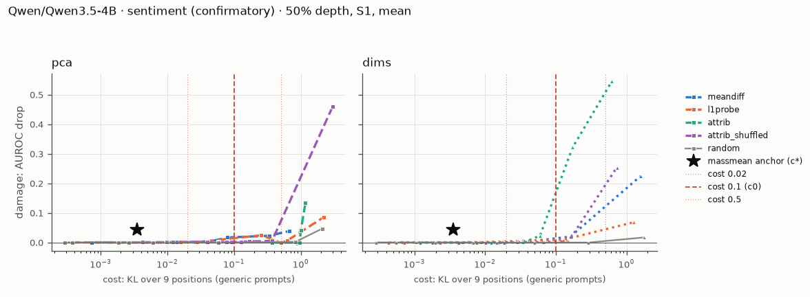

*How to read this.*

- **Layout:** there is one panel per basis (no SAE panel: it was excluded for this model). The
  horizontal axis is cost (log scale) and the vertical axis is damage (AUROC drop).
- **Markers:** each coloured line is a selection rule, and grey is random. The red dashed line marks
  the comparison cost c₀ = 0.1. The fainter dotted lines mark the secondary costs 0.02 and 0.5
  (Section 4.11). The black star is the mass-mean reference: very cheap (cost 0.0035) and weak
  (0.04 AUROC drop).
- **Raw dims (right):** the green causal line rises steeply right at the comparison cost and reaches
  a 0.17 drop there. The readout rules (blue, orange) and random (grey) stay near zero until much
  higher costs.
- **PCA (left):** nothing does anything at the comparison cost.

**Why causal picking does nothing in PCA here.** The PCA axes that attribution picks first are the
expensive ones. For this pair, switching off even the *single* first axis it picks already costs
0.37, almost four times the comparison cost. So at a cost of 0.1, causal picking in PCA cannot switch
off anything at all. Readout rules pick cheaper axes and get a little damage in. The same happens in
a few other cells, though not everywhere.

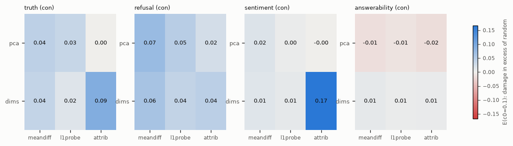

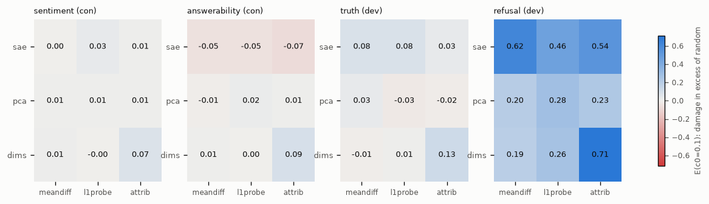

*How to read these.*

- **Layout:** each cell is E at the comparison cost, i.e. damage beyond random picking, for one
  basis (row) and one rule (column). Darker blue means more damage than random; red means less.
  Panel titles say whether a pair is confirmatory ("con") or development ("dev").
- **Setting:** all cells use mean ablation at 50% depth, site S1 (prompt tokens only). This is the
  primary setting fixed in the preregistration. Section 4.11 shows the same heatmaps at costs 0.02
  and 0.5.
- **What stands out:** in the confirmatory panels, the only clearly blue cells are raw dims × attrib.
  Most other cells sit within ±0.05 of zero: at this cost and depth, most methods barely dent these
  behaviours.
- **Refusal on Qwen3-1.7B** (a development pair, bottom row, right) is the exception: there every
  method does real damage.

**Is the raw-dims advantage specific to the task?** The scrambled-label control (S4a) gives a split
answer:

- **On Qwen3.5-4B, yes.** Attribution with scrambled labels did nothing. For sentiment it caused a
  0.002 drop against 0.167 for real attribution.
- **On Qwen3-1.7B, not clearly.** For sentiment, scrambled-label attribution in raw dims did *more*
  damage than the real thing (0.11 vs. 0.08).
  - It picked nearly the same dimensions without the labels: the same top 6, and 59 of the top 100.
    So the picks don't depend on the labels.
  - They do still seem tied to the task. The cross-task control, computed after the freeze, finds
    they hurt answerability far less than sentiment (Section 4.7).
  - The development pairs fail the scrambled-label control in every basis.

### 4.4 C2: two flips out of six

C2 looks for a flip in which basis wins between readout and causal picking. Three flips were needed
for C2 to hold; two pairs had one.

**How the test works.**

- **One test per combination.** There is one test for every pair, every two bases A and B, and each
  readout rule (`meandiff`, `l1probe`). That is 6 tests for each Qwen3-1.7B pair (three bases) and 2
  for each Qwen3.5-4B pair (two bases): 20 tests in all.
- **Each test compares two differences in excess damage E,** both at cost 0.1:
  - **Readout difference** = E of the readout rule in basis A − E of the same rule in basis B.
    Positive means A wins under readout picking.
  - **Causal difference** = E of `attrib` in A − E of `attrib` in B. Positive means A wins under
    causal picking.
- **A test passes only if both of these hold:**
  - The two differences point in opposite directions, and both are reliable: one CI is entirely
    above 0 and the other entirely below 0.
  - It survives the multiple-testing correction. The test's p-value is the larger of the two
    differences' p-values, corrected across all 20 tests, and must reach q ≤ 0.05.
- **A pair has a flip** if at least one of its tests passes.

**Results, pair by pair.** For each pair, the test that came closest to a flip. Brackets are 95% CIs.

| Pair | Flip? | Closest test (A − B, rule) | Readout difference | Causal difference | q | Why |
|---|---|---|---|---|---|---|
| 1.7B sentiment | **Yes** | SAE − dims, `l1probe` | +0.032 [+0.015, +0.047] | −0.067 [−0.148, −0.012] | 0.010 | A flip. PCA − dims under `l1probe` flips too (+0.013 vs. −0.068, q = 0.010). |
| 1.7B answerability | No | PCA − dims, `l1probe` | +0.015 [−0.001, +0.029] | −0.082 [−0.165, −0.029] | 0.105 | The readout CI just touches zero. In the other five tests, both kinds of rule prefer the same basis. |
| 4B truth | **Yes** | PCA − dims, `l1probe` | +0.019 [+0.006, +0.033] | −0.091 [−0.137, −0.053] | 0.010 | A flip. |
| 4B refusal | No | PCA − dims, `meandiff` | +0.012 [−0.028, +0.051] | −0.020 [−0.050, +0.011] | 0.673 | Neither difference is reliable. |
| 4B sentiment | No | PCA − dims, `meandiff` | +0.003 [−0.004, +0.011] | −0.168 [−0.216, −0.130] | 0.505 | Causal picking strongly prefers raw dims, but readout picking ties the bases. |
| 4B answerability | No | PCA − dims, `l1probe` | −0.016 [−0.030, −0.004] | −0.023 [−0.040, −0.007] | 0.020 | Both kinds of rule prefer raw dims, so nothing reverses. |

All 20 tests are in `analyze/confirmatory.json` under `C2`.

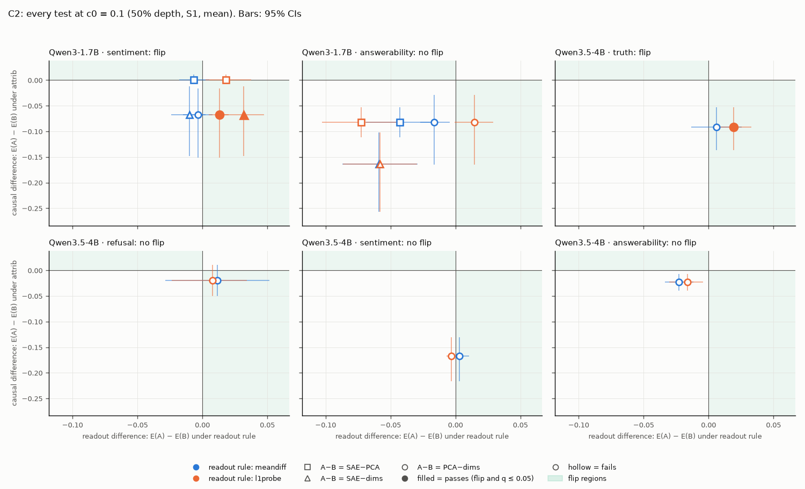

*How to read this.*

- **Layout:** one panel per pair. Each point is one test. The horizontal axis is the readout
  difference and the vertical axis the causal difference; the bars are their 95% CIs.
- **Markers:** colour shows the readout rule; shape shows which two bases are compared (A − B).
- **Flip regions:** the shaded corners are where the two differences point in opposite directions.
  A test passes only if its whole cross of error bars lies inside a shaded corner and q ≤ 0.05.
  Passing tests are filled; failing ones are hollow.

**What the plot shows.**

- **Causal picking has a clear direction.** 18 of the 20 points sit below the horizontal line, 16 of
  them reliably. In every comparison, A is the earlier basis in the order SAE, PCA, raw dims, so
  below the line means causal picking favours the later basis. In practice, that is mostly raw dims.
- **The readout side is flat.** Outside Qwen3-1.7B answerability, every readout difference is within
  ±0.033 of zero, and most CIs cross it. At this cost and depth, readout picking barely separates the
  bases, so in most pairs there is no reliable preference to reverse.
- **Qwen3-1.7B answerability fails the other way.** There, readout picking also favours the later
  basis (points left of the vertical line), so the two kinds of rule agree.

Both flips have the same shape as v1's: raw dims look worse than the other bases under readout
picking but best under causal picking. At cost 0.5, readout picking separates the bases more and
three pairs flip, all in the same direction (Section 4.11, post-freeze).

The basis-dependence the run *did* find is of a different kind. Causal picking's advantage exists in
raw dims and not in PCA or SAE. C2 asks a narrower question (does the ranking of two bases flip?),
and that flip was reliable in only two pairs.

### 4.5 C3: holds, with a strong caveat

The correlation between a group's readout strength and its damage was 0.07 (CI −0.05 to 0.15), well
under the 0.3 bar, so C3 holds. But look at the size of the damage:

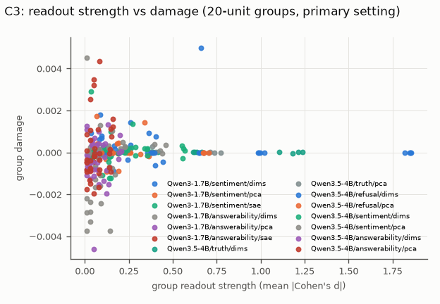

*How to read this.* Each dot is a group of 20 units. The horizontal axis is how clearly the group
separates the two classes (higher = clearer). The vertical axis is the damage from switching the group
off. Almost every group sits within ±0.005 of zero, including the groups with the clearest readout
signal on the right.

So switching off 20 units at a time at the middle layer does essentially nothing, whatever their
readout strength. With almost no damage to predict, a near-zero correlation says little. C3 holds by
its rule, but it is weak evidence. The related control S4c (does attribution's *predicted* damage
track the measured damage?) found the same near-zero result, 0.06, for the same reason.

### 4.6 Depth: the middle layer was the quiet one

This is a secondary, descriptive analysis. It was not a pre-registered test, it ran with fewer
repeats at the non-primary depths, and the controls were run only at 50%. Still, it is the most
striking result of the run.

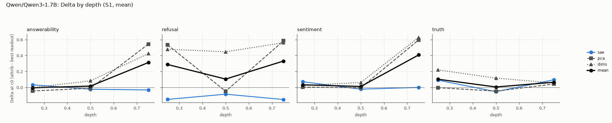

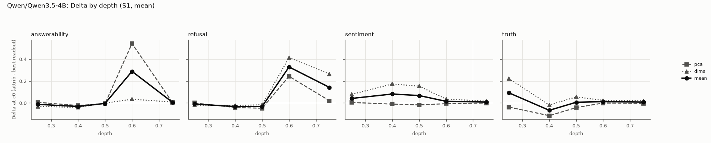

*How to read these.*

- **Layout:** there is one panel per task. The horizontal axis is depth; the vertical axis is Δ, causal
  picking's advantage over the better readout rule at cost 0.1.
- **Lines:** each thin line is a basis (blue = SAE, dashed = PCA, dotted = raw dims). The thick black
  line is the average, the number C1 uses. Above zero means causal picking wins.

What stands out:

- **Large effects appear away from the middle.**
  - On Qwen3-1.7B at 75% depth, causal picking cut sentiment AUROC by about 0.6 (raw dims and PCA),
    while readout picking did essentially nothing (0.001). The same holds for answerability (0.43–0.55
    vs. under 0.01).
  - On Qwen3.5-4B at 60% depth, the same happens for answerability (0.56 vs. 0.01 in PCA) and refusal
    (0.44 vs. 0.03 in raw dims).
- **There is no single "good" depth.** Each task peaks at a different depth: truth on Qwen3.5-4B
  is highest at 25%, sentiment at 40–50%, and refusal and answerability at 60%.
- **SAE features** (Qwen3-1.7B, blue) do not share in the large late-layer effects.
  - At 75% depth, causal picking's advantage there is about zero or negative for sentiment,
    answerability and refusal. Truth is the exception, at +0.10.
  - For refusal it is negative at every depth.

In plain terms, the pre-registered middle layer happened to be where these behaviours were hardest
to break at a modest cost. Where they can be broken, causal picking is often far ahead of readout
picking. One open question is whether late-layer causal picking simply finds the directions the model
uses to write its answer word. That would make the large effects less surprising.

### 4.7 Other secondary results

- **S2, editing generated tokens (refusal, 50% depth).**
  - On Qwen3.5-4B, it made no reliable difference to causal picking's advantage (difference 0.02,
    CI −0.001 to 0.035).
  - On Qwen3-1.7B (development), causal picking's advantage was smaller with generated tokens edited
    (difference −0.06).
- **S3, mean vs. resample ablation (refusal).**
  - On Qwen3.5-4B, the two strategies ranked the methods quite differently (rank agreement −0.07, CI
    −0.47 to 0.33; with only 6 methods to rank, this is very uncertain).
  - On Qwen3-1.7B (development), they agreed moderately (0.50).
- **S4b, cross-task control (computed after the freeze).**
  - **What it tests:** whether units picked by causal picking for one task also damage another task.
    - On each model, tasks were swapped in pairs: sentiment ↔ answerability and truth ↔ refusal.
    - This was done with 50 and 200 units, in every basis, at 50% depth.
    - The frozen rule calls the picks *specific* if the other task's units do less than half the
      excess damage of the task's own units.
  - **Why it's late:** the 40 interventions ran normally, but the frozen analysis step returned
    nothing.
    - The code read the "resample" column in a way pandas takes as its built-in `resample` method.
      So the code never found the task's own units to compare against.
    - Nothing else in the analysis code reads a column that way.
    - The summary was computed afterwards with only that fixed (`src/pilot/post_freeze_s4b.py`), so
      it is a post-freeze result.
  - **Headline by the frozen rule:** 36 of 40 comparisons count as specific (27 of 28 confirmatory).
  - **That headline overstates it.** In 17 of the 40, the task's own units did almost no damage at 50
    or 200 units (excess damage below δ = 0.05), so there was nothing to compare and the rule passed
    by default.
    - This covers every comparison for Qwen3.5-4B sentiment, answerability and truth.
    - The 0.05 cut is a reading aid added here, not part of the frozen rule.
  - **Where a test is possible** (23 comparisons): 18 reliably specific, 3 unclear, 2 reliably not
    specific.

    | Task hurt ← units picked for | Testable | Specific | Unclear | Not specific |
    |---|---|---|---|---|
    | Qwen3.5-4B refusal ← truth | 3 of 4 | 3 | | |
    | Qwen3.5-4B sentiment, answerability, truth | 0 of 12 | | | |
    | Qwen3-1.7B sentiment ← answerability | 4 of 6 | 4 | | |
    | Qwen3-1.7B answerability ← sentiment | 4 of 6 | 2 | 2 | |
    | Qwen3-1.7B refusal ← truth (development) | 6 of 6 | 6 | | |
    | Qwen3-1.7B truth ← refusal (development) | 6 of 6 | 3 | 1 | 2 |

  - **Examples:**
    - **Refusal, both models:** truth's units barely touch refusal, while refusal's own units cut it
      by 0.5–0.7.
    - **Qwen3-1.7B sentiment, raw dims:** answerability's 200 units changed sentiment by 0.005;
      sentiment's own 200 units by 0.33.
    - **Qwen3-1.7B truth, raw dims (not specific):** refusal's units hurt truth by about 0.09,
      nearly as much as truth's own units (0.12).
  - **How it fits with the scrambled-label control (Section 4.3):**
    - On Qwen3-1.7B sentiment, causal picking chose nearly the same raw dims with scrambled labels.
    - Yet sentiment's picks did less than a third of the damage to answerability that answerability's
      own picks did, while answerability's picks barely touched sentiment.
    - So the picks look tied to the task, though not to its labels.

### 4.8 The SAE for Qwen3.5-4B was excluded at every depth, because of a scaling error

An SAE is used only if, at that layer, it reproduces the model's internal state well: it must explain
at least 70% of the variation (FVE), and swapping in its reconstruction may raise the model's error
on normal text by at most 10%.

| Layer (depth) | Variation explained | Error increase | Included? |
|---|---|---|---|
| Qwen3-1.7B: 7, 14, 21 | 82–88% | −2% to +2% | Yes, all three |
| Qwen3.5-4B: 8 (25%) | 7% | +149% | No |
| Qwen3.5-4B: 13 (40%) | negative (worse than predicting the average) | +95% | No |
| Qwen3.5-4B: 16 (50%) | 10% | +89% | No |
| Qwen3.5-4B: 19 (60%) | 50% | +58% | No |
| Qwen3.5-4B: 24 (75%) | 65% | +24% | No |

**Why it failed: the SAE received activations at the wrong scale.** This was found after the run.

- **What the SAE expects:** it was trained on activations rescaled to a standard size. Its model card
  calls this "global RMS" normalisation: rescaling so the average squared length equals the number of
  dimensions. The evidence below shows that the file does not apply this rescaling itself, so whoever
  uses the SAE must apply it.
- **What the harness did:** it passed the model's raw activations. At layer 16 these are about 5 times
  smaller than the SAE expects.
- **Why:** the setting came from reading the model card and the SAE authors' code, which appeared to
  pass raw activations. That reading was wrong.

**The evidence.** It was checked after the run, using the layer-16 SAE file and 13,052 real layer-16
activation vectors that the run had saved (from the refusal prompts):

| What the SAE was given | Variation explained | Active features per token (designed: 128) |
|---|---|---|
| Raw activations, as in the run | 15% (the official check measured 10%, on other prompts) | 62 |
| Rescaled ×4.6 (global RMS, computed from our model's activations) | 70% | 103 |
| Rescaled ×5.5 (the scale at which the SAE activates its designed 128 features) | 71% | 128 |

Two more observations point the same way:

- **The SAE's built-in "average activation"** points in the same direction as the model's real
  average activation (similarity 0.82), but is 3.7 times longer.
- **The pattern across layers fits.** The model's activations grow with depth: their typical size is
  about 8 at layer 8 and 28 at layer 24. So the mismatch shrinks with depth, and the measured fit rose
  from 7% to 65%. Only layer 16 was tested directly, because its SAE file was the one available
  locally.

**Would the SAE have been included with the right scaling?** Possibly, but only just.

- At layer 16 it explains 70–71% of the variation, right at the 70% bar, and that was measured on
  different prompts than the official check.
- The second condition (an error increase of at most 10%) can only be checked by running the model.

**Why the run didn't catch it.** The harness originally had a check that tried the SAE at neighbouring
layers and with alternative input scalings, including the one that fits here. That check would have
stopped the run on a mismatch. It was removed before the run so that a single-shot run could not be
halted by it, on the belief that the model card's setting was right.

Consequence: every Qwen3.5-4B result uses only PCA axes and raw numbers, and the SAE basis is
represented only by the two Qwen3-1.7B pairs. Section 5 discusses what this means for the verdict.

### 4.9 The references and H0: better than v1, still often failing

- **Truth now breaks a little.** In v1, removing the truth direction did nothing; AUROC even rose
  slightly, by 0.004. In v2, with the statement's own words edited, it cuts truth AUROC by 0.09 on
  Qwen3-1.7B.
- **The refusal reference now clears its bar on Qwen3-1.7B.** It cut refusals by 0.64 (0.66 with
  generated tokens edited), against v1's 0.43 and the 0.5 bar. H0 still fails there, because random
  SAE features did 32% of the reference's damage (the bar is 25%).
- **References are cheap and mostly weak.** At 50% depth, the reference's cost (c\*) was 0.0008–0.03
  for every pair, far below the comparison cost of 0.1. For the single-answer tasks it caused at most a
  0.06 AUROC drop in the confirmatory pairs (0.09 for truth on Qwen3-1.7B).
- **Qwen3.5-4B's refusal is hard to break.** Its reference cut refusals by only 0.16, and at a cost of
  0.1 no method managed more than 0.08. This model refuses 97% of harmful requests and holds on to that.

H0 passed for 4 of the 6 confirmatory pairs at 50% depth: 1.7B sentiment, and 4B truth, sentiment
and answerability. It failed for 1.7B answerability (random SAE features did 27% of the reference's
damage) and 4B refusal (reference too weak). As planned, this is a caveat only and changes nothing
above.

### 4.10 The development pairs (Qwen3-1.7B truth and refusal)

These were reported but never counted.

- **Refusal is where things happen.** At cost 0.1, causal picking in raw dims cut the refusal rate by
  0.81, against 0.29–0.36 for readout picking. This is the same picture as v1 (0.70 vs. 0.35–0.39).
  With SAE features, though, readout picking already did as well as or better than causal picking
  (0.84 vs. 0.75).
- **Both pairs fail C1, for the same reason as the confirmatory pairs.** The causal advantage is large
  in raw dims (0.12 for truth, 0.45 for refusal) and negative in the other bases. It is reliably
  negative in PCA for truth and in SAE for refusal.
- **Both pairs show a C2 flip.** On these familiar tasks, C2 would have held.
- **The scrambled-label control fails in every basis** for both development pairs. This is a warning
  about how specific the effects are, on the tasks we know best.
- **The cross-task control (post-freeze) splits them.**
  - Refusal's picks are cleanly specific.
  - Truth's are not, in raw dims: refusal's units hurt truth almost as much as truth's own units
    did (Section 4.7).

### 4.11 Other comparison costs (post-freeze, exploratory)

Every test above is read at the pre-registered cost c₀ = 0.1. The preregistration also names 0.02
and 0.5 as secondary costs, but the frozen report gives them only as a per-cell table. To see how
much the conclusions depend on the choice of 0.1, the frozen analysis code was rerun after the
freeze with only the comparison cost changed. The script is `src/pilot/post_freeze_costs.py`. At 0.1
it reproduces the official numbers exactly.

**None of this changes the verdict.** Choosing the comparison cost after seeing the results is exactly
what preregistration exists to prevent. These are patterns to follow up, not findings.

**What the same rules would conclude at each cost:**

| Cost | C1 (needs 5 of 6) | C2 (needs 3 of 6) | Label from C1 and C2 |
|---|---|---|---|
| 0.02 | 0 of 6 | 0 of 6 | NOT SUPPORTED |
| **0.1 (pre-registered)** | **0 of 6** | **2 of 6** | **NOT SUPPORTED** |
| 0.5 | 1 of 6 | 3 of 6 | PARTIALLY SUPPORTED |

At 0.5, C2 would just reach its bar. C1 would still fail badly: only one pair passes, and none on
Qwen3.5-4B.

**The causal advantage Δ (average over bases) at each cost.** 50% depth, S1, mean ablation. Brackets
are 95% CIs; bold marks CIs that exclude zero.

| Pair | Cost 0.02 | Cost 0.1 | Cost 0.5 |
|---|---|---|---|
| 1.7B sentiment | −0.003 [−0.008, 0.003] | 0.012 [−0.008, 0.042] | **0.120 [0.099, 0.145]** |
| 1.7B answerability | **−0.007 [−0.012, −0.003]** | 0.016 [−0.002, 0.047] | **0.132 [0.104, 0.165]** |
| 4B truth | **−0.002 [−0.007, −0.000]** | 0.006 [−0.010, 0.025] | −0.008 [−0.029, 0.010] |
| 4B refusal | **−0.015 [−0.029, −0.006]** | **−0.032 [−0.055, −0.014]** | **−0.082 [−0.125, −0.041]** |
| 4B sentiment | **−0.002 [−0.005, −0.001]** | **0.068 [0.048, 0.091]** | **0.177 [0.153, 0.200]** |
| 4B answerability | **−0.003 [−0.006, −0.001]** | −0.004 [−0.012, 0.006] | −0.001 [−0.025, 0.022] |

**Per basis at cost 0.5:**

| Pair | Δ in dims | Δ in pca | Δ in sae | C1 at 0.5 |
|---|---|---|---|---|
| 1.7B sentiment | **0.275** | **0.168** | **−0.084** | Fails: reliably worse in SAE |
| 1.7B answerability | **0.298** | **0.112** | −0.014 | **Passes** |
| 4B truth | **0.143** | **−0.160** | — | Fails: the two bases cancel out |
| 4B refusal | **−0.122** | −0.043 | — | Fails: causal picking is worse |
| 4B sentiment | **0.386** | **−0.032** | — | Fails: reliably worse in PCA, although q = 0.002 |
| 4B answerability | **0.104** | **−0.106** | — | Fails: the two bases cancel out |

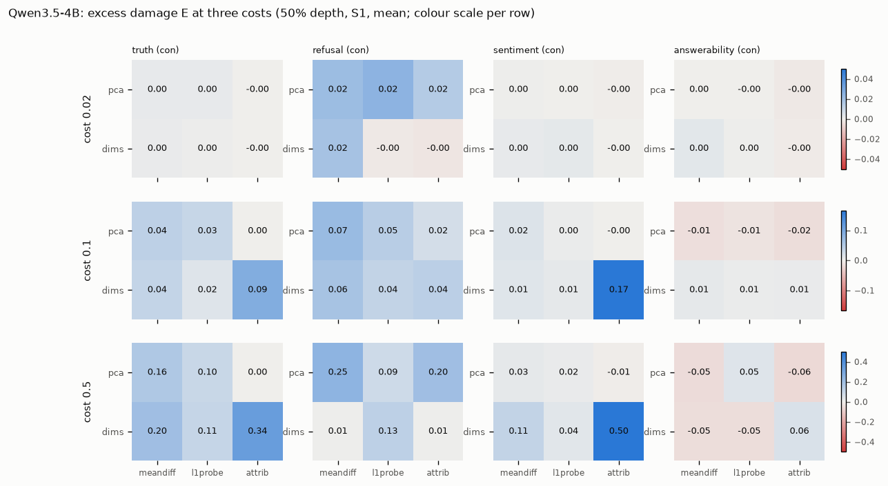

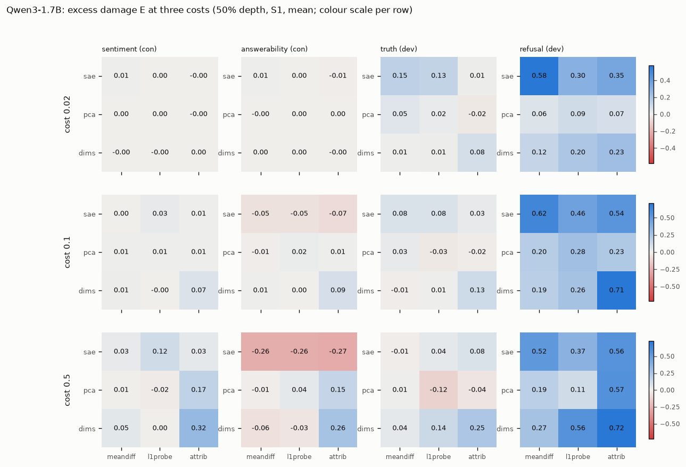

*How to read these.* Each row of panels is one cost; the middle row is the heatmap from Section 4.3.
Each cell is E, the damage beyond random picking. Each row has its own colour scale, because damage
grows a lot with cost, so compare colours within a row and read the printed numbers across rows.
The red SAE row for Qwen3-1.7B answerability at 0.5 doesn't mean the rules undid damage. Random SAE
picks alone already cut AUROC by 0.29 there, more than any rule did.

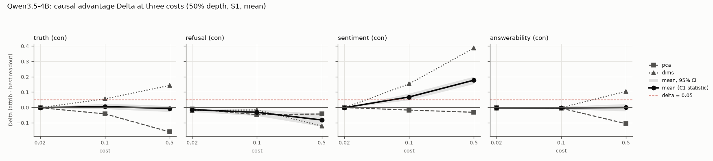

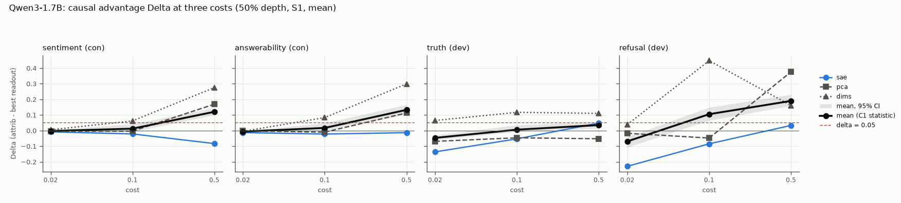

*How to read these.* One panel per pair. The black line is the C1 statistic (Δ averaged over bases)
with its 95% CI as a grey band; the other lines are Δ in each basis. The red dashed line is the 0.05
bar. A pair can pass C1 only where the black band sits above the bar and no basis line is reliably
below zero.

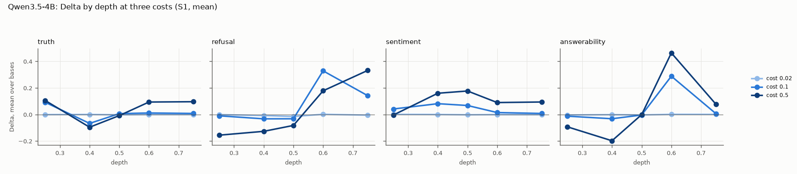

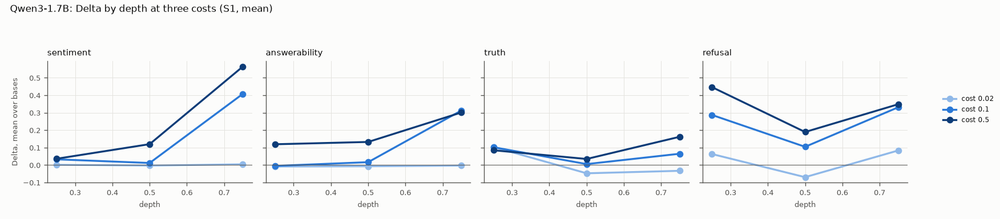

*How to read these.* The Section 4.6 depth plots, with one line per cost (lighter = cheaper). On
Qwen3-1.7B answerability at 25% and 75% depth, two curves (SAE features picked by `l1probe`) run
out of units before reaching cost 0.5. There the value at 0.5 is the curve's maximum.

**What the other costs suggest (unofficial):**

1. **0.1 sits where the curves start to rise.**
   - At 0.02, almost nothing beats random in the confirmatory pairs. Causal picking is never ahead,
     and readout picking is very slightly ahead in five pairs.
   - At 0.5, the causal advantage is large in three pairs: 0.12–0.18.
   - So the pre-registered cost happens to sit on the steep part. A somewhat higher cost would have
     made the results look much more favourable to causal picking.
2. **Even at 0.5, the basis decides.** C1 fails at 0.5 for the same reason as at 0.1: in most pairs
   one basis goes the other way.
   - Raw dims favour causal picking in 5 of 6 pairs (by 0.10–0.39).
   - PCA favours it on Qwen3-1.7B (0.11–0.17) but opposes it on Qwen3.5-4B (−0.03 to −0.16).
   - SAE features never favour it in the confirmatory pairs.
3. **Every flip goes the same way.**
   - Put the bases in the order SAE, PCA, raw dims. In every C2 flip found, readout picking favours
     the basis earlier in that list, and causal picking favours the one later in it.
   - This holds at every cost and in the development pairs too. It is also the direction v1 saw (PCA
     beat raw dims under readout rules; raw dims beat PCA under attribution).
   - It is the most consistent pattern in the data, even though C2's per-pair test catches it only
     sometimes.
4. **On Qwen3-1.7B, the large-cost wins are not task-specific.** At 0.5, causal picking with
   scrambled labels did about as much damage as with the real labels:

   | Pair, basis | Real `attrib` E at 0.5 | Scrambled `attrib_shuffled` E at 0.5 |
   |---|---|---|
   | 1.7B sentiment, dims | 0.32 | 0.38 |
   | 1.7B answerability, dims | 0.26 | 0.21 |
   | 1.7B answerability, pca | 0.15 | 0.18 |
   | 1.7B truth (dev), dims | 0.25 | 0.38 |
   | 4B sentiment, dims | 0.50 | 0.19 |
   | 4B truth, dims | 0.34 | −0.01 |

   - **On Qwen3-1.7B,** causal picking at high cost seems to find units that matter for the model in
     general. Switching enough of them off breaks any task. One possible reason: even with
     meaningless labels, the most extreme attribution scores tend to go to units with the biggest
     influence on the score, so the ranking partly reflects influence, not the task. This is an
     interpretation, not something the run tested.
   - **On Qwen3.5-4B,** real labels clearly beat scrambled ones, so its wins look task-specific.
5. **Refusal on Qwen3.5-4B goes against causal picking at every cost.** Δ is −0.015, −0.032 and
   −0.082. The first-token stand-in score (Section 2.5) is one candidate explanation, untested.
6. **Depth: on Qwen3.5-4B, later layers favour causal picking and earlier ones favour readout
   picking, more strongly as cost grows.**
   - At 60% and 75% depth, Δ is reliably positive for all four tasks at both 0.1 and 0.5. At 0.5 it
     ranges from 0.08 to 0.46.
   - At 25% and 40% depth, Δ at 0.5 is reliably negative in five of the eight depth–task
     combinations: readout picking does better there once more collateral damage is allowed.
   - On Qwen3-1.7B, Δ at 0.5 is positive at every depth for every task. It is largest at 75% for
     three tasks; refusal peaks at 25%.

---

## 5. What this means

1. **The central claim is not supported.** "Causal picking beats readout picking" is not a general rule
   at the pre-registered setting. It holds in one basis (raw dimensions), fails in PCA, and reverses in
   SAE features.
2. **The basis matters, just not in the way C2 tests.** Whether causal picking helps depends strongly
   on which kind of unit you use. That is the kind of method dependence this project is about, but
   C2's specific test (a reliable flip in the ranking of two bases) caught it in only two pairs.
3. **The comparison point was demanding.** At 50% depth and a cost of 0.1, most methods barely
   affected the single-answer tasks, so many comparisons were between very small numbers. Deeper
   layers show large effects and large causal advantages. The pre-registered choice of depth turned
   out to be the least favourable one for detecting differences. The cost was similar: at 0.5,
   causal advantages are much larger, although still basis-dependent (Section 4.11, post-freeze).
4. **Several results are weaker than they look:**
   - C3 holds mainly because small groups of units did nothing.
   - On Qwen3-1.7B, causal picking chose nearly the same raw dims with scrambled labels. The
     cross-task control suggests those picks are still tied to the task, but it was computed after
     the freeze.
   - The cross-task control can't be tested for three of the four Qwen3.5-4B tasks, because their
     own units did almost nothing at 50 or 200 units.
   - The SAE basis is absent for the larger model, because of a scaling error in the harness
     (Section 4.8).
5. **The v1 fixes worked as intended.**
   - Editing every prompt token made truth breakable and lifted the refusal reference over its bar.
   - Every curve reached its comparison cost.
   - The machinery passed all its checks.

### Do the two gaps undermine the verdict?

Two things were missing from the run's report: the cross-task control (S4b) and the SAE basis on
Qwen3.5-4B. Neither makes the run invalid; the verdict follows correctly from the frozen rules and
the data that exist. The first has since been recovered from the saved data. The second weakens half
of the verdict.

**The cross-task control**

- **It can't change the verdict.** It is a secondary check of whether units picked for one task are
  specific to that task, and it is not part of C1–C3 or the label.
- **The bug is contained.**
  - The 40 cross-task interventions ran normally; only the summary step failed, because of a
    one-word bug that affects nothing else in the analysis code (Section 4.7).
  - One headline result was also recomputed directly from the raw intervention data, bypassing the
    analysis code. Qwen3.5-4B sentiment gives Δ = 0.153 in raw dims, −0.018 in PCA and 0.068 on
    average, exactly as reported.
- **It has been recovered without a rerun,** as a post-freeze analysis (Section 4.7).
  - Where it can be tested, the picks are mostly task-specific.
  - The exception is Qwen3-1.7B truth in raw dims.
  - It can't be tested for three of the four Qwen3.5-4B tasks.

**The SAE basis on Qwen3.5-4B**

- **Why it's missing:** a scaling error in the harness (Section 4.8), not the SAE's quality. The
  inclusion rule worked as written; it was given wrongly scaled inputs.
- **No wrong SAE numbers entered the results,** because the SAE was excluded everywhere.
- **C1's "no" does not depend on it.**
  - Three of the four Qwen3.5-4B pairs already fail C1 because causal picking was reliably worse in
    PCA, and adding a basis cannot undo that.
  - Both Qwen3-1.7B pairs fail with the SAE included.
  - So at most 1 of 6 pairs could have passed with the SAE, and C1 needs 5.
- **C2's "no" could have changed.**
  - With only PCA and raw dims, each Qwen3.5-4B pair had one pair of bases that could flip; with the
    SAE it would have had three.
  - C2 was one flip short (2 of 6, needing 3). One more flip would have made C2 hold and the label
    PARTIALLY SUPPORTED.
- **That "could have" is uncertain twice over.** Correctly scaled, the SAE only just meets the quality
  bar at layer 16, so it might still have been excluded. And if included, it might not have produced
  a flip.
- **It narrows the scope.** Every SAE conclusion rests on two Qwen3-1.7B pairs, and the second model
  does not test SAE features at all.
- **Recovering it** would need the Qwen3.5-4B SAE cells to be rerun with the corrected scaling,
  reported as a post-freeze addition. The setting has since been corrected in `config/v2.yaml`
  (`input_norm: rms_d`, changed 2026-11-20, after the freeze), so any such rerun is a recorded
  deviation. Only layer 16 matters for C2; the confirmatory run spent about 2.5 GPU hours per basis
  there on this model.

**In short:** C1's "no" is solid. C2's "no" is the fragile part of the verdict: with the SAE in
place, the label could have been PARTIALLY SUPPORTED. The other departure from the plan, the
time-budget override (Section 6), touches only secondary results.

**Open questions this run raises:**

- With the correct input scaling, does the Qwen3.5-4B SAE pass the quality check, and does it change
  C2?
- Why are effects so much larger at 60–75% depth? Is late-layer causal picking finding the answer
  word's direction?
- Is a fixed cost of 0.1 a sensible comparison point for tasks this hard to break?
- On Qwen3-1.7B, why does causal picking choose nearly the same units with scrambled labels, when
  those units still look specific to the task?

---

## 6. How the run went

### Timeline (19 November 2026, NVIDIA GB10)

All five steps were driven by one script (`run_v2.sh`), which stops at the first error and resumes
from where it stopped.

| Time | Event |
|---|---|
| 03:04 | Start. Downloads (models, SAEs, datasets: 18.7 GB) took about 3 minutes. |
| 03:23 | Smoke test stopped by the memory safety guard (free memory fell to the 16 GB floor). Resumed. |
| 04:51 | Smoke test failed one check (described below). The check was fixed and the smoke test resumed. |
| 05:20 | Smoke test passed: 37 checks passed, 0 failed, 1 noted (it took 28.5 min against a 25-min target). |
| 05:20–06:18 | Development run (58 minutes). |
| 06:18 | Preregistration finalised, committed, frozen and tagged. |
| 06:40, 08:06 | Confirmatory run stopped twice by the memory safety guard. The batch size of the gradient step was halved (this affects speed only) and the run resumed. |
| 13:41 | The operator stopped the run and restarted it with the time budget raised from about 11 to 18 hours. |
| 22:49 | Confirmatory run finished. All five blocks were completed; none were skipped. |

### The smoke-test check that failed

One check generates replies in the normal step-by-step way and in a single full pass, and requires
the same words from both. On Qwen3-1.7B, 31 of 32 words matched. The one mismatch was a near-tie:
two candidate words were almost equally likely, and tiny rounding differences between the two ways
of computing decided between them. The check was changed to tolerate such near-ties, which is a
harness fix, not a change to any result. Every other machinery check passed on both models:

- Switching a unit "off" to its own value changes nothing, including during generation.
- A do-nothing intervention has exactly zero cost.
- The freeze protection refuses to run after a frozen file is edited.

### The time budget was raised mid-run

The plan was 12 hours for the development and confirmatory runs together. Before the run, the smoke
test projected that the confirmatory run alone would take about 18.7 hours, and that blocks B3–B5
would not fit. Nothing was dropped from the plan before freezing, and the time guard was left to skip
blocks during the run.

At 13:41, during block B3, the operator raised the budget to 18 hours with an override
(`PILOT_V2_CONFIRM_HOURS=18`).

- **What the override changed:** under the original budget, B3 would still have run, but **B4 and B5
  would have been skipped**. B4 is refusal with generated tokens and with resample ablation. B5 is
  the 40% and 60% depths of Qwen3.5-4B.
- **What it didn't affect:** the primary results (C1, C2) come from B1, and C3 from B2, which had
  finished before the change.
- **What depends on it:** the depth results at 40% and 60% on Qwen3.5-4B, including the large effects
  at 60% in Section 4.6, and the site and strategy results for Qwen3.5-4B, exist only because of the
  higher budget.
- **How it was recorded:** because the override did not edit a frozen file, the report lists "no
  deviations". Readers should treat it as a deviation from the 12-hour plan.

In total the confirmatory run used about 14.4 GPU hours: about 30 minutes of preparation and 13.9
hours of interventions. With the 58-minute development run, the two came to about 15.3 hours against
the planned 12.

### Run facts

| Item | Value |
|---|---|
| Models | Qwen/Qwen3-1.7B and Qwen/Qwen3.5-4B (chat versions) |
| Depths | Qwen3-1.7B: layers 7, 14, 21. Qwen3.5-4B: layers 8, 13, 16, 19, 24. Primary: 50%. |
| SAEs | `adamkarvonen/qwen3-1.7b-saes` (65,536 features), included at all three layers. `Carlos4869/REINS-SAE` (20,480 features), excluded at all five layers because it was given inputs at the wrong scale (Section 4.8). |
| Confirmatory pairs | 1.7B sentiment and answerability; 4B truth, refusal, sentiment and answerability |
| Development pairs | 1.7B truth and refusal |
| Interventions | Confirmatory run: 4,881 (4,272 on the main grid, 609 controls). Development run: 485. |
| Comparison cost | c₀ = 0.1 (KL over 9 reply positions on 100 ordinary prompts) |
| Smallest effect of interest | δ = 0.05 (in AUROC or refusal-rate units) |
| Machine | NVIDIA GB10 (aarch64, 128 GB shared memory) |

---

## 7. Glossary (new or changed since v1)

| Term | Meaning |
|---|---|
| Attention sink | A token with unusually huge internal values that the model uses as a resting place for attention. Never edited. |
| Attribution | Causal picking's score for a unit: the predicted change in the task score if that unit alone were switched off, signed so that damage is negative (Section 2.5). |
| Block (B1–B5) | A chunk of the run plan. Blocks run in priority order, so the least important ones are dropped first if time runs short. |
| c₀ | The fixed cost (0.1) at which all methods are compared. Replaces v1's c\* as the comparison point. |
| C1, C2, C3 | The pre-registered claims (Section 3). |
| Confirmatory pair | A model–task pair that counts toward the verdict. |
| Development pair | A model–task pair we had already studied (Qwen3-1.7B truth and refusal). Reported, never counted. |
| Δ (causal advantage) | Excess damage of causal picking minus that of the better readout rule, in one basis. |
| Depth | How far through the model the intervention happens (50% = the middle layer). |
| E (excess damage) | A method's damage minus random picking's damage, at the same cost and in the same basis. |
| Freeze | Fingerprinting and tagging the hypotheses, settings and analysis code, so they cannot change unnoticed. |
| FVE | Fraction of variation explained: how well an SAE reproduces the model's internal state (1 = perfectly). |
| Generated tokens | The words the model writes in its reply. |
| Preregistration | Writing down and freezing the hypotheses and analysis before running the test. |
| q-value | A p-value corrected for running many tests at once. |
| Rank correlation (Spearman, Kendall) | Whether two lists put things in the same order: 1 = same order, 0 = unrelated, −1 = reversed. |
| Site (S1, S2) | Which tokens are edited: S1 = all prompt tokens; S2 = also every generated token. |
| Scrambled-label attribution (`attrib_shuffled`) | Causal picking computed with the group labels shuffled. A control: it should be no better than random. |
| Tier 1, Tier 2 | The full design at 50% depth, and the lighter design at the other depths. |
| Unit direction | How the residual stream moves when a unit's value rises by 1: a one-hot vector (`dims`), a PCA axis (`pca`) or an SAE decoder row (`sae`). |

For v1 terms (ablation, basis, AUROC, KL divergence, mass-mean direction, PCA, SAE, unit, and so on),
see the glossary in `pilot-results-explained.md`.

## 8. Where to find things

Run folders are under `runs/feature-ablation-v2-runs_20-11-2026/`.

| File | Contents |
|---|---|
| `pilot-v2-amendment.md` | The full v2 specification (written as instructions for the code) |
| `confirm/20261119-061824-confirm/report_v2.md` | The machine-generated confirmatory report, with every number and plot |
| `confirm/…/analyze/confirmatory.json` | Every statistical test behind C1–C3 |
| `confirm/…/analyze/secondary.json` | Depth, site, strategy, controls, references |
| `confirm/…/analyze/exploratory/cells_exploratory.csv` | Damage and excess damage at costs 0.02, 0.1 and 0.5 for every cell, basis and rule |
| `confirm/…/ablate/results.parquet` | One row per intervention |
| `confirm/…/inclusion.json` | Entry checks for tasks and SAE quality |
| `confirm/…/analyze/post_freeze/s4b_cross_task.json` | The cross-task control, computed after the freeze (Section 4.7) |
| `src/pilot/post_freeze_s4b.py` (in the repo) | The script that computed it: the frozen analysis with the one-word fix |
| `confirm/…/analyze/post_freeze/costs.json` | C1, C2, depth and scrambled-label results at costs 0.02, 0.1 and 0.5, computed after the freeze (Section 4.11) |
| `src/pilot/post_freeze_costs.py` (in the repo) | The script that computed them and drew the Section 4.11 figures: the frozen analysis with only the cost changed |
| `dev/20261119-052018-dev/dev_report.md` | The development run's report |
| `smoke/20261119-030739-smoke/smoke_report.md` | Every machinery check and the time projections |
| `pipeline/run_v2.log` | The timeline of the whole run |
| `figures/pilot-v2/` (next to this document) | The plots used here: copied from the confirmatory run, plus the `*_costs_*` figures drawn by `post_freeze_costs.py` and `c2_tests.png` drawn by `src/pilot/plot_c2.py` (which only reads `confirmatory.json`) |
